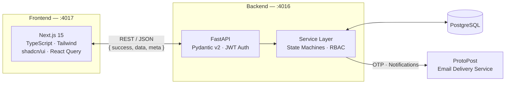
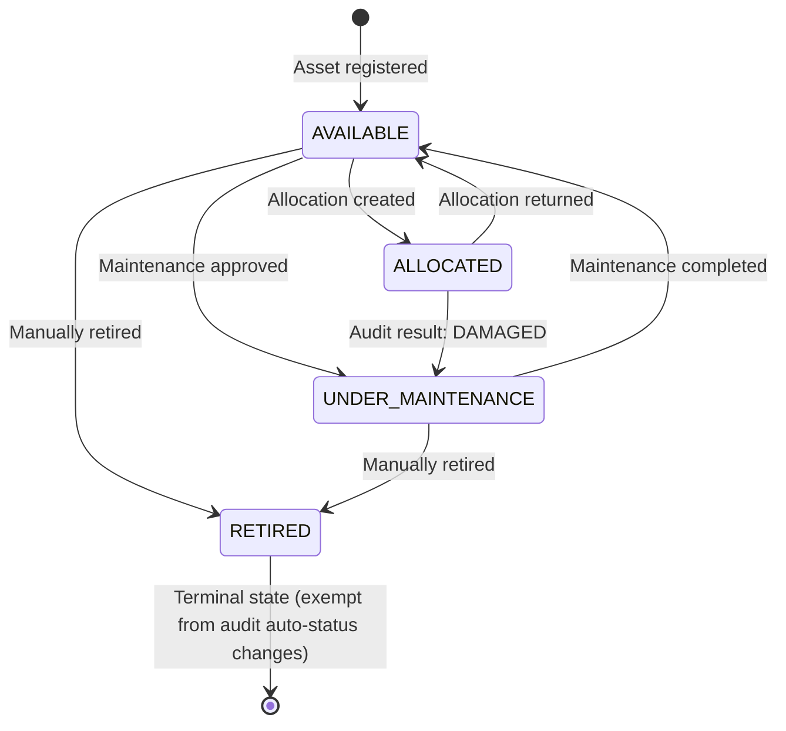
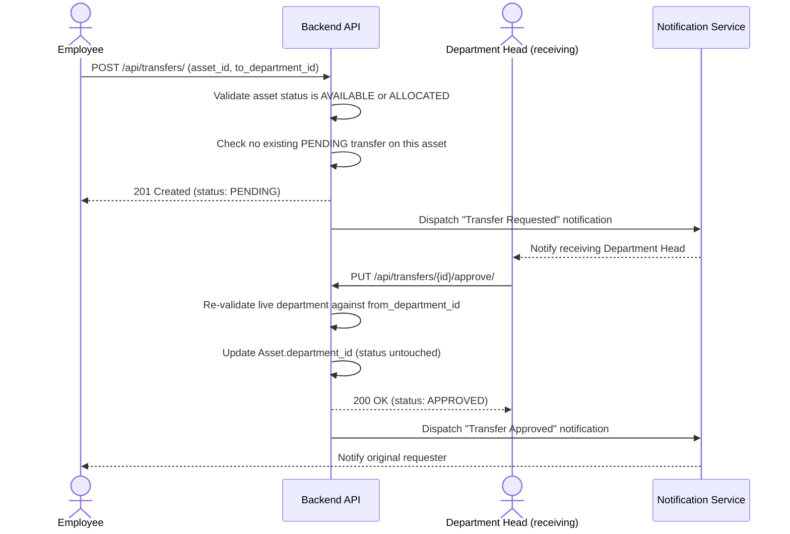

<div align="center">

# 🗂️ AssetFlow

### Enterprise Asset & Resource Management System

*Track every asset. Approve every transfer. Book every room. Audit everything — in one place.*

[](https://fastapi.tiangolo.com/)
[](https://nextjs.org/)
[](https://www.postgresql.org/)
[](https://www.typescriptlang.org/)
[](#license)

**Built for Odoo Hackathon 2026**

</div>

---

## 📖 Overview

**AssetFlow** is a full-stack Enterprise Resource Planning (ERP) module purpose-built for organizations that need to manage physical assets — laptops, vehicles, meeting rooms, lab equipment — across departments, at scale, without a spreadsheet in sight.

It replaces the usual chaos of asset tracking — "who has the ThinkPad?", "is Meeting Room A free at 3?", "did anyone actually approve that transfer?" — with a single source of truth: a real state machine behind every asset, role-scoped visibility for every department, and a full audit trail from the moment an asset is registered to the moment it's retired.

Built **contract-first** so the frontend and backend teams could move in parallel: the API shape was frozen early, business rules were logged and decided explicitly as edge cases came up, and both sides of the stack were built against the same source of truth throughout.

---

## ✨ Key Features

| Module | What it does |
|---|---|
| 🔐 **Auth & RBAC** | Signup with OTP email verification, JWT sessions, optional login 2FA, and five distinct roles (`Admin`, `AssetManager`, `DepartmentHead`, `Employee`, unassigned `User`) enforced on every single endpoint |
| 🖥️ **Asset Registry** | Full lifecycle tracking across a real state machine — `AVAILABLE ↔ ALLOCATED ↔ UNDER_MAINTENANCE → RETIRED` — with department scoping and QR-code lookup |
| 📦 **Allocations** | Checkout/return workflow that drives asset status directly — no asset can ever be `ALLOCATED` without a live allocation record, or vice versa |
| 🔁 **Transfers** | Cross-department asset movement with receiving-side approval, duplicate-pending guards, and live re-validation at approval time so a stale request can never silently move an asset from wherever it now actually sits |
| 📅 **Bookings** | Conflict-free scheduling for shared resources (meeting rooms, vehicles, projectors) with real overlap detection — no asset can be double-booked, and only genuinely available assets can be reserved |
| 🛠️ **Maintenance** | Request → approve → complete workflow with automatic asset-status side effects and a fully auto-populated maintenance log per asset |
| 🔍 **Audits** | Org-wide stock verification — flag assets `FOUND` / `DAMAGED` / `MISSING`, with automatic status changes wired straight into the same state machine everything else respects |
| 🔔 **Notifications** | Real-time, event-driven alerts across every workflow (allocation, transfer, booking, maintenance, audit) with in-app + email delivery and user-level preferences |
| 📊 **Dashboard & Reports** | Live Admin overview plus six generation-ready report types spanning inventory, allocations, transfers, maintenance, bookings, and audits |
| 🕓 **Activity Log** | Every state-changing action across the entire system, queryable by user, module, and date range — a complete, tamper-proof history of who did what and when |

---

## 🏗️ Architecture



- **Contract-first**: every endpoint, role requirement, and response shape is frozen in a single OpenAPI-backed contract before either side builds against it.
- **Service-layer state machines**: asset status is never written directly from a route — it's always a side effect of the allocation, transfer, maintenance, or audit workflow that's supposed to own it, enforced in one place.
- **RBAC by default**: every route is guarded; there is no implicitly-open endpoint anywhere in the system except the public auth routes.
- **Event-driven notifications**: every meaningful workflow action dispatches its own notification and activity-log entry inline, not as a disconnected batch job.

### Asset Lifecycle State Machine

Every asset's status is driven entirely by real workflow actions — allocation, transfer, maintenance, and audit — never written directly.



> `MISSING` audit results also map to `UNDER_MAINTENANCE`, mirroring `DAMAGED`, except on assets already `RETIRED` — those stay terminal by design.

---

## 🧰 Tech Stack

**Frontend**
- Next.js 15 (App Router) · TypeScript · Tailwind CSS · shadcn/ui · React Query

**Backend**
- FastAPI · SQLAlchemy 2 · Alembic · Pydantic v2 · PostgreSQL · JWT Auth

**Tooling**
- `uv` for Python dependency management · Pytest for backend testing · Faker-seeded demo data for reproducible, realistic local environments

---

## 🔁 Example Workflow: Cross-Department Transfer



---

## 🚀 Getting Started

### Prerequisites

- Python 3.11+ and [`uv`](https://docs.astral.sh/uv/)
- Node.js 18+ and a package manager (`npm`/`pnpm`/`yarn`)
- PostgreSQL 14+
- [ProtoPost](https://github.com/pgokul695/ProtoPost) — local email delivery service (setup covered in step 2 below)

### 1. Clone the repo

```bash
git clone <repo-url>
cd assetflow
```

### 2. Set up ProtoPost (email delivery)

AssetFlow sends every OTP and Phase 6 notification email through **[ProtoPost](https://github.com/pgokul695/ProtoPost)**, a lightweight local email-delivery service. It's a separate dependency — clone/download it from its own repo and run it alongside the backend:

- **Linux**: run the included binary directly —
  ```bash
  ./Protopost_linux
  ```
- **Windows / macOS**: no bundled binary in-repo — download the appropriate build from the [ProtoPost releases page](https://github.com/pgokul695/ProtoPost) and run it the same way.

By default ProtoPost listens on `http://localhost:5978` with **no auth token required** — leave the `Authorization` header off entirely when the backend calls it. Leave this running in its own terminal for the whole session.

### 3. Backend setup

```bash
cd backend
cp .env.example .env          # set DATABASE_URL, JWT_SECRET, and PROTOPOST_URL=http://localhost:5978
uv sync
uv run alembic upgrade head
uv run python scripts/seed_demo.py --reset   # populates realistic demo data
uv run uvicorn app.main:app --reload --port 4016
```

Backend runs at `http://localhost:4016` — interactive API docs at `http://localhost:4016/docs`.

### 4. Frontend setup

```bash
cd frontend
cp .env.example .env.local    # set NEXT_PUBLIC_API_URL=http://localhost:4016
npm install
npm run dev -- --port 4017
```

Frontend runs at `http://localhost:4017`.

### 5. Run the test suite

```bash
cd backend
uv run pytest --cov=app
```

---

## 🔑 Demo Access

The seeder builds a fully interconnected demo organization — **TechNova Solutions Pvt Ltd** — with 41 users, 65 assets, active and historical workflows across every module, and notifications/activity-log entries generated inline as real side effects, not fabricated filler. Every non-pending seeded account has a working password through the real auth path, so you can log in and explore each role directly:
## Admin
- **Alex Mercer** — alex.mercer@technova.io — `password123`


| Role | Example login | What you'll see |
|---|---|---|
| `Admin` | `admin@technova.io` | Full org visibility, dashboard, reports, role assignment |
| `AssetManager` | *(see seed output)* | Unscoped asset/allocation/transfer/maintenance/audit control |
| `DepartmentHead` | *(see seed output)* | Department-scoped views, transfer approvals for their department |
| `Employee` | *(see seed output)* | Personal allocations, bookings, and transfer requests |
See Full list in [Demo Accounts](./docs/demo_acc.md)
Run the seeder and check its console summary for the full generated credential list.

---

## 📚 Documentation

| Doc | Purpose |
|---|---|
| `docs/api-reference.md` | Full endpoint reference — paths, roles, request/response shapes |
| `docs/business-rules-reference.md` | The *why* behind every validation rule and state transition |
| `docs/architecture-notes.md` | System structure, conventions, and design decisions |
| `docs/glossary.md` | Entity and enum reference |
| `http://localhost:4016/docs` | Live, interactive Swagger UI generated straight from the running backend |

---

## 🧪 Quality & Testing

- Unit tests for every state machine and business rule
- Full integration coverage across all API modules
- A dedicated RBAC test matrix — every endpoint × every role, verified
- Contract-level tests for envelope shape, error handling, and route conventions
- End-to-end workflow tests chaining signup → asset lifecycle → notifications → reporting

---

## 👥 Team

Built with ❤️ for **Odoo Hackathon 2026**

| Name | GitHub |
|---|---|
| **Gokul P** | [@pgokul695](https://github.com/pgokul695) |
| **Keerthana Vinod** | [@Keerthana-Vinod](https://github.com/Keerthana-Vinod) |
| **Vandana S** | [@Vandana-001](https://github.com/Vandana-001) |

---

## 📄 License

This project is licensed under the MIT License — see the [LICENSE](LICENSE) file for details.


**AssetFlow** — because your organization's Assets shouldn't be tracked in a shared spreadsheet.

